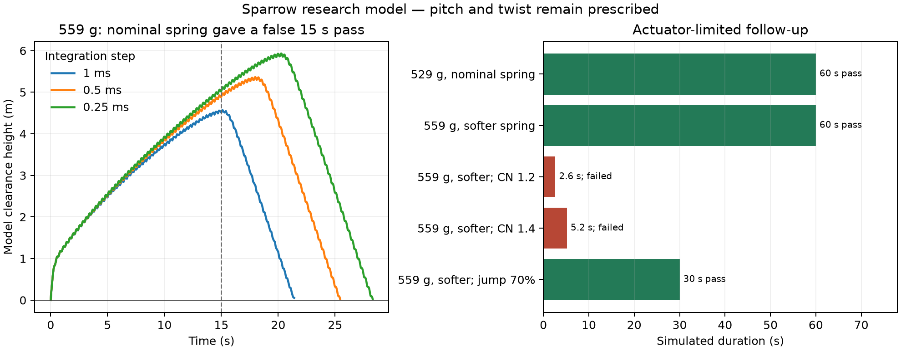

# Sparrow continuation: finite startup and limited actuators

14 November 2026 — additive research only; no master CAD or working controller changes.

## Outcome

There is now a stronger full-feature research candidate: a 559 g point-mass robot with dynamically simulated wing hinges remains airborne for 60 seconds under the default aerodynamic assumptions, with explicit torque and instantaneous power saturation. It uses a softer hinge spring and a carefully timed startup. It is NOT yet a validated robot design: launch efficiency, aerodynamics, twist, attitude stabilization, motor/transmission feasibility and hardware mass are still unverified.

This continuation executed **409 additional trajectories**. Peak sampled CPU was **18.46%**; peak RAM **65%**. All batches finished, with one simulation worker at a time and an 85% stop threshold. Source hashes remained unchanged.

## What changed in the experiments

1. Finite startup replaces instantaneous full wing speed. The commanded angular speed follows a smooth cosine ramp; wing position, speed and acceleration are differentiated consistently. Initial wing phase and flap delay are explicit. A zero-ramp compatibility check matched the original force function to 2.85e-14; independent derivative and spring/inertia energy checks passed.
2. A centerline ground-clearance check uses the copied model’s 0.165 m standing base height, hinge offset (−0.060 m forward, +0.070 m up) and 0.62923 m aerodynamic-strip tip radius. This can reject an obvious intersection but cannot certify full-wing clearance: chord edges, feather deformation, folding and actual body pose remain absent.
3. Inverse-dynamics screens measure hinge torque, pair mechanical power and ideal spring assistance. Their provisional gates are 4 Nm per hinge, 50 W mean positive mechanical power, 100 W instantaneous positive pair power. These are screening choices, not established motor ratings.
4. The final actuator model actually integrates wing angle and angular velocity. Each identical hinge actuator uses inertia/spring feedforward plus PD feedback, clipped by torque and positive power. No exact aerodynamic feedforward is supplied. The spring, air torque and clipped actuator torque jointly accelerate the wing. Saturation can alter the wingbeat and the flight trajectory. Body pitch and wing twist remain prescribed.

## Startup and model-formulation findings

The first 72 finite-startup cases (0.15 s flap delay) produced one airborne result. It required raised wings, a 0.15 s acceleration ramp, default CN=1.6 and 80% jump efficiency. With ideal springs it demanded 108 W peak mechanical power, exceeding the selected 100 W screening gate.

A second, 256-case timing screen varied mass 529/559 g, frequency 3.5/4 Hz, startup ramp 0.1/0.2 s, delay 0/0.05/0.1/0.15 s, jump efficiency 50/80%, CN 1.2/1.6, and fixed/scaled body drag. Three settings passed the spring-assisted load gates, all at 529 g and 80% launch efficiency. The best zero-delay, 0.1 s ramp case passed at 2, 1 and 0.5 ms steps, demanding approximately 33.5 W mean / 93.1 W peak mechanical power and 2.93 Nm peak per hinge.

Only one of 128 timing-screen cases with 50% launch efficiency stayed airborne; none passed the selected load gates. This is not proof that lower-efficiency jumping cannot work, but these particular candidates do not provide that margin.

Separately, fixed body drag instead of scaling BODY_CDA with wing area changed a nominal 559 g, delayed-start trajectory from falling to passing. Correcting the previously identified lateral-resultant inconsistency also changed that outcome. These four formulation cases isolate numerical-model choices; the final actuator candidate deliberately retains the original force closure and area-scaled body drag. Neither isolated fix has been silently incorporated into the working project.

## Actual actuator-limited outcomes

All cases below use area x3, ±45° commanded stroke, 3.5 Hz, a 13 J launch at 45°, 80% conversion efficiency, raised wings at release and a 0.1 s ramp. The force model uses CN=1.6 and suction efficiency 0.7. Mean/peak power is mechanical at the pair of wing hinges, not battery input. A passing trajectory is not controlled level flight.

| Case | Duration / outcome | Torque limit per hinge | Pair peak power limit | Mean mechanical W | Measured peak hinge Nm |
|---|---|---:|---:|---:|---:|
| 529 g, nominal hinge spring | 60 s, airborne | 2.5 Nm | 80 W | 31.96 | 2.50 |
| 559 g, 20% softer hinge spring | 60 s, airborne | 4.0 Nm | 100 W | 36.24 | 3.11 |

Both 60-second cases passed at 0.5 and 0.25 ms integration steps. The 529 g case uses a 2.36969 Nm/rad spring per hinge and Kp=40. The 559 g candidate uses 1.89575 Nm/rad per hinge and Kp=60; damping gain is 1.08444 Nm·s/rad. Controller feedforward retains the nominal spring value; the softer spring changes the actual motion and phase rather than simply removing inertial cost.

The untuned 559 g candidate is a counterexample: it passed at 15 seconds but hit the ground at 21.45, 25.46 and 28.32 seconds using 1, 0.5 and 0.25 ms steps. Its exact failure time is numerically sensitive, so it must not be reported as stable sustained flight. A 20% stiffer spring failed sooner; 25% greater wing inertia and a softer spring sometimes improved tracking/flight. This coupled result contradicts a blanket assumption that lighter wings always improve this controller.

## Remaining uncertainty tests

| Softer-spring 559 g variant | Outcome | Simulated time |
|---|---|---:|
| CN=1.2, jump efficiency=80% | failed | 2.631 s |
| CN=1.4, jump efficiency=80% | failed | 5.192 s |
| CN=1.6, jump efficiency=70% | airborne at test end | 30.000 s |

These are deterministic sensitivity cases, not experimental success rates. The final candidate has not survived the whole uncertainty envelope. No physical capability is claimed. A modelled 60-second ascent does not establish indefinite endurance, pitch/roll stability, navigation or landing.

## Concrete candidate and hardware requirements

- Full-feature mass target: **559 g**, including a provisional **30 g** allowance above the existing 529 g BOM. The existing 36 g missing-item allowance was not counted twice. No detailed allocation proves that the new jump, wing, spring, twist and drive hardware fits these 30 g.
- Wing area: **0.498216 m²** across a **1.42 m** span (approximately 351 mm mean chord). Each wing still assumes **0.0049 kg·m²** inertia. Actual structural stiffness, mass and manufacturability remain open.
- Launch energy: **13 J**, assuming 80% becomes translation. The hinge springs additionally contain **1.169 J total** at the raised-wing starting pose. This preload is separate from the 13 J jump spring and must have a charging/holding mechanism.
- Softer spring: **1.89575 Nm/rad per hinge**, maximum restoring torque about **1.49 Nm** at 45°. Spring damping, hysteresis, fatigue, attachment loads and mass are not simulated.
- Finest-step run: mean positive mechanical power **36.24 W**, actual peak motor-hinge torque **3.11 Nm**, RMS **1.75 Nm** per wing. Pair peak power reaches the imposed **100 W** limit. The controller saturates for **6.6%** of time steps. Maximum wing speed is **17.37 rad/s** and actual peak stroke **45.62°**.
- Assuming 65% aggregate motor/drive efficiency solely for an electrical budget, ~36 W mechanical implies ~56 W electrical average before electronics and spring charging. That is not a measured input power, a motor specification, or a validated battery load. Negative mechanical work is discarded; no electrical regeneration is credited.
- A shared crank/gearbox, motor torque-speed curve, motor rotor inertia, current limits, winding temperature, ESC behavior and battery voltage sag are not included. The ideal hinge-actuator result cannot select an 1806 motor or an arbitrary gear ratio. Peak hinge torque is not motor-shaft torque.
- The source model’s original physical stroke is ±31°. The wider stroke, larger wings and added springs exist only in these experiments. No master CAD approval or modification is implied.

## Literature cross-check

The reference ornithopter study reports a 180 g aircraft, an approximately 3 J jump spring, and failed takeoffs when flapping started before jumping or too late. It supports examining launch synchronization but does not validate Sparrow’s 559 g configuration, prescribed twist or power estimates. [Li et al., npj Robotics (2026)](https://www.nature.com/articles/s44182-025-00067-8).

## Next engineering gate

Keep the softer-spring configuration as a bench-test target, not a build-ready design. Measure paired-wing lift/thrust versus stroke phase, frequency and twist, then measure spring/drive losses and real launch efficiency. Use these to replace CN, drag, twist and efficiency assumptions. Develop the motor/transmission and complete mass budget before any CAD change. A coupled body-attitude model and controlled landing still follow; this work has not quietly bypassed them.

Useful acceptance data for the rig: true force waveforms and cycle means; root and drive loads; actual twist; loaded wing speed; shaft/mechanical versus electrical input; startup response; temperatures; structural deflection; and spring energy recovered per cycle. The deployment/ground-clearance and jump launch must be checked in the full geometry, not just the centerline proxy.

## Reproducibility and preservation

New deterministic trajectories by batch: phase2: 102, phase2_timing: 268, phase2_actuator: 18, phase2_actuator_check: 14, phase2_actuator_long: 7. No random seeds are involved.
The isolated scripts and all JSONL run records, raw convergence traces, resource logs, source hashes and compatibility tests are retained. The first preflight attempt stopped on a missing test-function argument before any trajectory ran; it was corrected, and the error log is retained. All completed simulations exited cleanly. The project’s original preservation check is included separately.
No simulations remain running after these bounded batches. One-second resource sampling cannot exclude shorter system-wide spikes. All sources hashed before and after each batch matched. No originals were refactored or overwritten.
